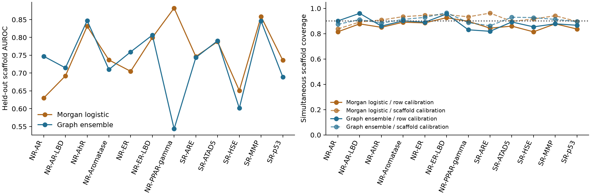

# Toxicity Scaffold Lab

[](https://github.com/aarnavbhat23/toxicity-scaffold-lab/actions/workflows/graph-and-results.yml)

A bond-aware molecular graph model, a fingerprint baseline, and a scaffold-level uncertainty experiment on twelve Tox21 assays.

The first release trains two message-passing models on **7,822 canonical molecules** derived from 7,831 upstream rows. Whole Murcko scaffolds are assigned to training, validation, calibration and testing. Missing assay labels never become inactive examples.



## Results

| Model | Macro test AUROC | Mean scaffold coverage, row calibration | Mean scaffold coverage, scaffold calibration |
|---|---:|---:|---:|
| Morgan fingerprint + logistic regression | 0.755 | 86.5% | 91.8% |
| Two-seed message-passing ensemble | 0.733 | 88.4% | 90.8% |

Coverage is the mean across twelve assays of the fraction of scaffolds for which **all labeled molecules** are covered. The target is 90%. Prediction sets can contain zero, one or both assay labels. Larger coverage is accompanied by larger sets: graph-model mean set size increases from 1.067 to 1.162 with scaffold calibration. A singleton can still be incorrect. Exchangeability of scaffold groups is required for the conformal argument; this dataset does not establish generalization to a new laboratory, time period or clinical use.

The graph ensemble loses to the fingerprint baseline in macro AUROC. Individual assay performance varies substantially; every assay and prediction is exposed in the result files. These numbers use our split and are **not a MoleculeNet leaderboard comparison**. The useful contribution is a compact, inspectable experiment tying model evaluation and uncertainty to the same chemical dependence unit.

## Run it

```bash
python -m venv .venv
source .venv/bin/activate
python -m pip install -r requirements.txt
python -m unittest discover -s tests -v
python replay.py
python predict.py 'CCO'
# Rebuild the experiment, without an API or paid service:
python fetch.py
python experiment.py --device cpu
python plot.py
```

The recorded graph models trained on CPU. `--device mps` or `--device cuda` is available when the installed PyTorch build supports graph index operations. The CPU path is the tested reproduction path. Python 3.13 was used. Released checkpoints and the logistic coefficients let you run inference without fitting a model.

## Choices that affect interpretation

- Canonical isomeric SMILES merge duplicates. Conflicting duplicate labels would be masked per assay; the recorded source has none after this merge. Molecules outside 1–128 atoms are excluded by a stated rule. Source missingness is retained.
- Murcko scaffolds ignore stereochemistry. Every acyclic molecule shares one `[ACYCLIC]` group; the protocol does not claim this grouping represents all chemical similarity. Salts and tautomers are not standardized. Atom features omit chirality, and graph features omit bond stereochemistry.
- Seed 912 shuffles **2,324 scaffold groups**, assigning 70%/10%/10%/10% by group count. The resulting row counts are 6,336/444/566/476 because scaffold sizes vary. This is one split; a multi-split stability study remains outstanding.
- The network uses three bond-aware message-passing layers with GRU updates and mean graph pooling. It has twelve jointly trained assay heads, masked BCE, and train-only fitting. Two weight seeds, 912/913, selected epochs 25/14 by validation BCE; seed 912 reached the prespecified maximum epoch count. There was no test-guided retuning.
- The baseline uses radius-2, 2,048-bit Morgan fingerprints and one logistic model per observed assay. AUROC, average precision and Brier score are reported per assay. Scaffold-max nonconformity uses only the calibration partition.

`results/split-ledger.csv` records hashes, scaffolds and assignments. `results/test-predictions.csv` contains all observed test labels and both probabilities. `results/history.json`, `metrics.json`, `exclusions.json`, the learned weights and `replay.py` make the reported experiment checkable. Replaying results does not retrain the network or establish a biological safety claim.

## Prior work and data credit

Tox21 molecular prediction, message passing, scaffold splits and conformal prediction are established methods. This is original implementation and analysis, not a new model family or first-ever benchmark. Compare with [MoleculeNet](https://doi.org/10.1039/C7SC02664A), [DeepChem](https://github.com/deepchem/deepchem), and the [original NIH Tox21 challenge](https://tripod.nih.gov/tox21/challenge/data.jsp). The [Tox21 data portal](https://tox21.gov/data-and-tools/) describes the underlying public assays.

`fetch.py` pins DeepChem's public CSV by SHA-256. The raw dataset is downloaded from its upstream host rather than redistributed here. Code is MIT; upstream data and dependencies retain their terms and attribution. Predicted Tox21 activity is not a clinical toxicity assessment.

## Next test

Repeat the scaffold split across seeds, add stereochemistry-aware features, and evaluate on an independently collected assay set before claiming improved generalization. A reproduced baseline loss is a result, not a reason to hide the baseline.

Built with AI assistance; the released results are from completed runs. No independent review, adoption or state-of-the-art claim is implied.
